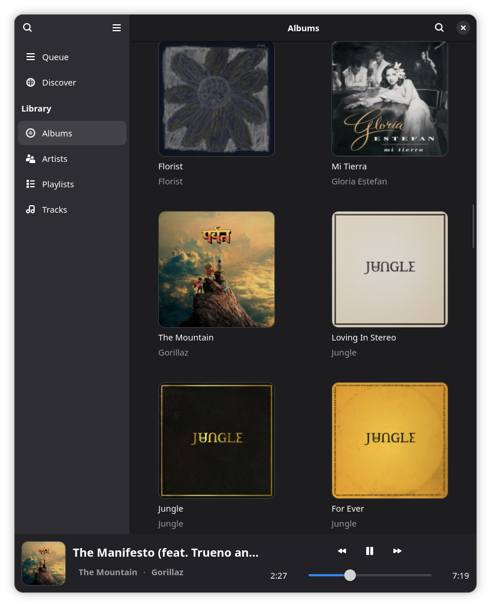

# Qobine

An Adwaita-based Qobuz client.



Listening to your Qobuz music with Qobine: an Adwaita Qobuz client designed for
GNOME.

## Installation

[](https://flathub.org/en/apps/io.github.sofusa.qobine)

Qobine is available on Flathub. Install with flatpak:

```sh
flatpak install flathub io.github.sofusa.qobine
```

## Usage

Upon first launch, a browser spawns where you will need to login to Qobuz with
your active streaming subscription.

## Features

Qobine is currently very bare bone, but more will follow.

- View and stream your favorite albums, artists and playlists
- Search the full Qobuz catalogue
- Add / remove favorites

## Contributions

Feature requests, issues and contributions are very welcome.
